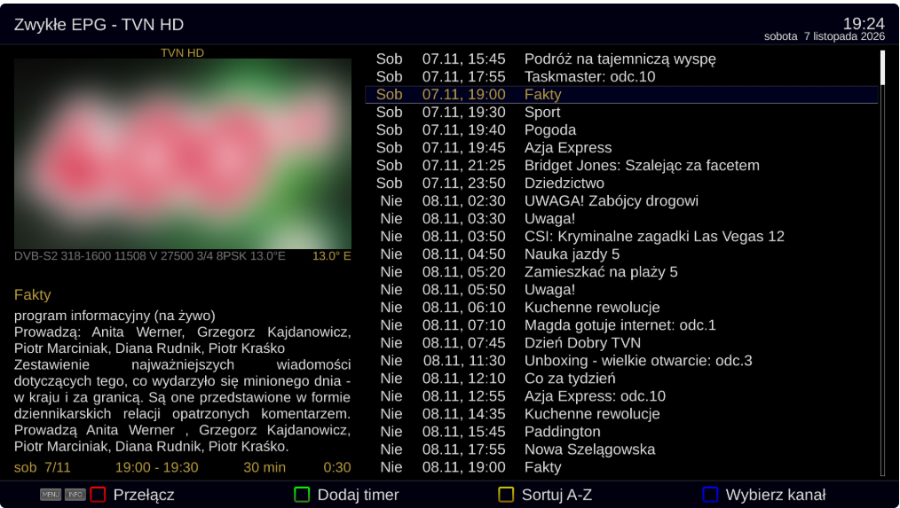
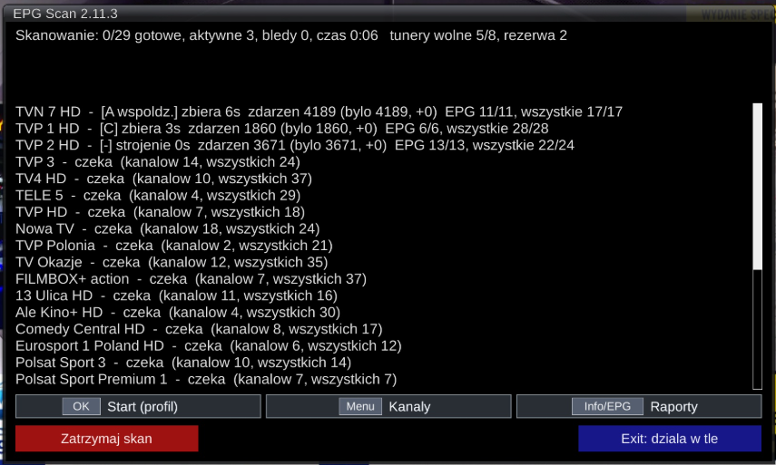
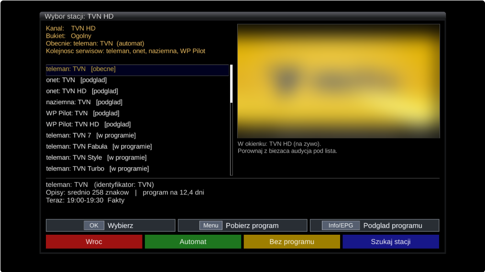

# EPG Scan – pełny EPG dla Enigma2 (+ serwer epgpl)

[English](README.en.md) | **Polski**

**EPG Scan** to wtyczka do odbiorników z Enigma2 (sprawdzana na OpenPLi 9.x, VU+ Uno 4K SE), która składa
pełny program telewizyjny z trzech źródeł:

- **skan satelity** – zbiera EPG (EIT) z transponderów Twoich bukietów, równolegle na wolnych tunerach,
  z rezerwą dla oglądania i nagrań;
- **program z internetu (XMLTV)** – polskie serwisy z programem TV (teleman.pl, onet.pl, pilot.wp.pl,
  programtv.naziemna.info) pobierane na dekoderze albo z serwera **epgpl**, dopasowane do kanałów z bukietów;
- **SatWatch** – pilnuje zmian na satelicie (`satellites.xml`, skan transponderów) i naprawia bukiety, gdy
  nadawca zmieni SID lub transponder.

Do tego harmonogram (nocny przebieg w czuwaniu), kopie EPG, raporty, sprzątanie dysku i restart po nocy.



<p> </p>

Więcej zrzutów w [opisie wtyczki](epgscan/EPGScan/README.md).

## Zawartość repozytorium

| Katalog | Co to jest | Opis |
|---|---|---|
| [`epgscan/`](epgscan/) | wtyczka Enigma2 (`/usr/lib/enigma2/python/Plugins/Extensions/EPGScan`) | [epgscan/EPGScan/README.md](epgscan/EPGScan/README.md) |
| [`epgpl/`](epgpl/) | **opcjonalny** serwer programu TV dla sieci domowej (Debian / Ubuntu) | [epgpl/README.md](epgpl/README.md) |

Serwer nie jest potrzebny – dekoder potrafi pobierać program z internetu sam. epgpl przydaje się, gdy chcesz
pobierać na komputerze, który i tak pracuje w nocy, albo obsłużyć kilka dekoderów.

## Instalacja wtyczki

Gotowe paczki są w [Releases](../../releases). Plik skopiuj do `/tmp` na dekoderze i zainstaluj:

```
opkg install /tmp/enigma2-plugin-extensions-epgscan_X.Y.Z_all.ipk && init 4; sleep 2; init 3
```

albo z archiwum ZIP:

```
rm -rf /usr/lib/enigma2/python/Plugins/Extensions/EPGScan;cd /tmp && unzip -o epgscan-X.Y.Z.zip -d /usr/lib/enigma2/python/Plugins/Extensions/;init 4; sleep 2; init 3
```

Pierwsze kroki, wszystkie ustawienia i najczęstsze pytania: [opis wtyczki](epgscan/EPGScan/README.md).
Całkowite usunięcie wtyczki z konfiguracją: [`epgscan/tools/epgscan_reset.sh`](epgscan/tools/epgscan_reset.sh).

## Instalacja serwera epgpl (opcjonalnie)

```
cd /tmp && rm -rf epgpl && unzip -o epgpl-X.Y.Z.zip && cd epgpl && sudo bash install.sh
```

Szczegóły: [epgpl/README.md](epgpl/README.md).

## Budowanie paczek ze źródeł

```
sh epgscan/build.sh                       # dist/epgscan-X.Y.Z.zip i dist/enigma2-plugin-extensions-epgscan_X.Y.Z_all.ipk
mkdir -p dist && zip -qr dist/epgpl-$(cat epgpl/VERSION).zip epgpl
```

Wersje: EPG Scan – `VERSION` w [`epgscan/EPGScan/common.py`](epgscan/EPGScan/common.py), epgpl – plik
[`epgpl/VERSION`](epgpl/VERSION). Tagi wydań: `epgscan-X.Y.Z`, `epgpl-X.Y.Z`. Historia: [CHANGELOG.md](CHANGELOG.md).

## Wsparcie

Jeśli EPG Scan Ci się przydaje i chcesz wesprzeć dalszy rozwój: **[buycoffee.to/jardol](https://buycoffee.to/jardol)**. Dziękuję!

## Zastrzeżenie

Program telewizyjny pobierany z serwisów (teleman.pl, programtv.onet.pl, pilot.wp.pl, programtv.naziemna.info) należy
do ich właścicieli. Wtyczka i serwer pobierają go do prywatnego użytku na własnym dekoderze – z przerwami między
zapytaniami i ograniczoną liczbą połączeń. Użytkownik odpowiada za to, by korzystanie z nich było zgodne z regulaminami
tych serwisów; nie udostępniaj pobranego programu innym osobom. Repozytorium zawiera wyłącznie kod i konfigurację – nie
zawiera pobranego programu. Oprogramowanie jest dostarczane bez jakiejkolwiek gwarancji (szczegóły w licencji GPL).

## Licencja

GNU GPL w wersji 2 lub (według wyboru) dowolnej późniejszej – [LICENSE](LICENSE), `SPDX-License-Identifier:
GPL-2.0-or-later` w plikach źródłowych. Kod i programy innych autorów, z których korzystają wtyczka i serwer,
oraz uwagi o danych z serwisów programu TV: [epgscan/EPGScan/THIRD_PARTY.md](epgscan/EPGScan/THIRD_PARTY.md),
[epgpl/THIRD_PARTY.md](epgpl/THIRD_PARTY.md).

Copyright (C) 2026 JarDol
