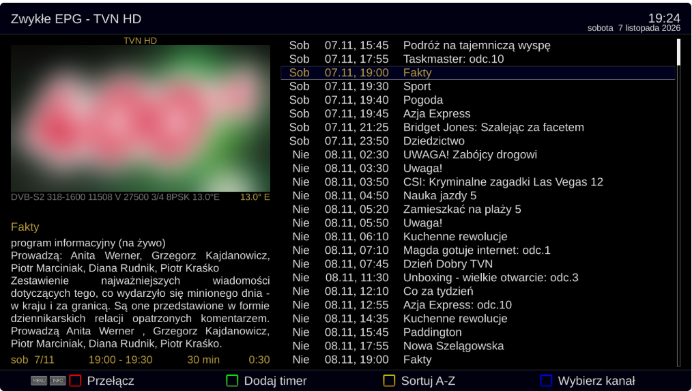
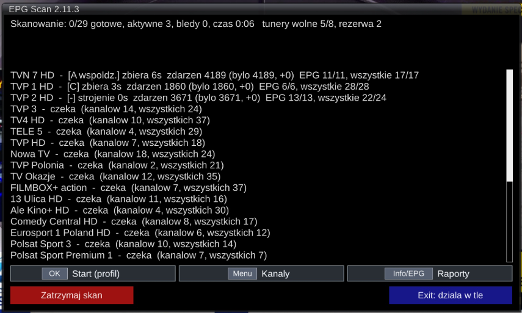
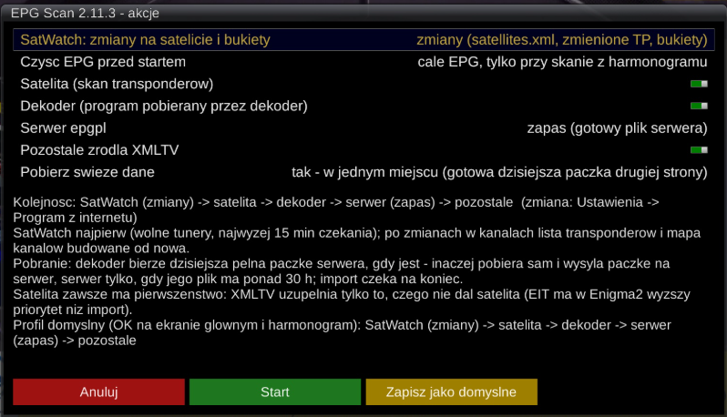
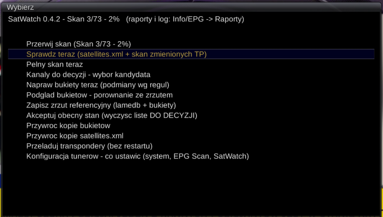
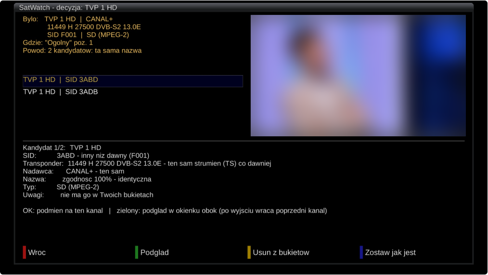
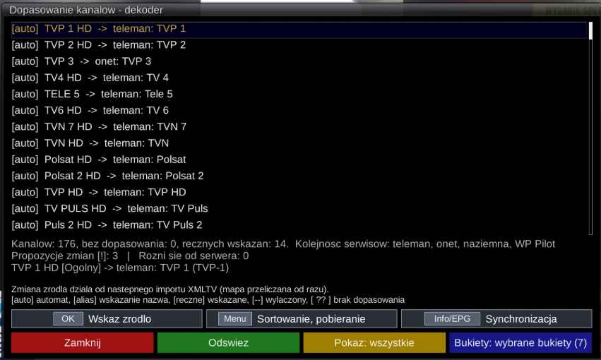
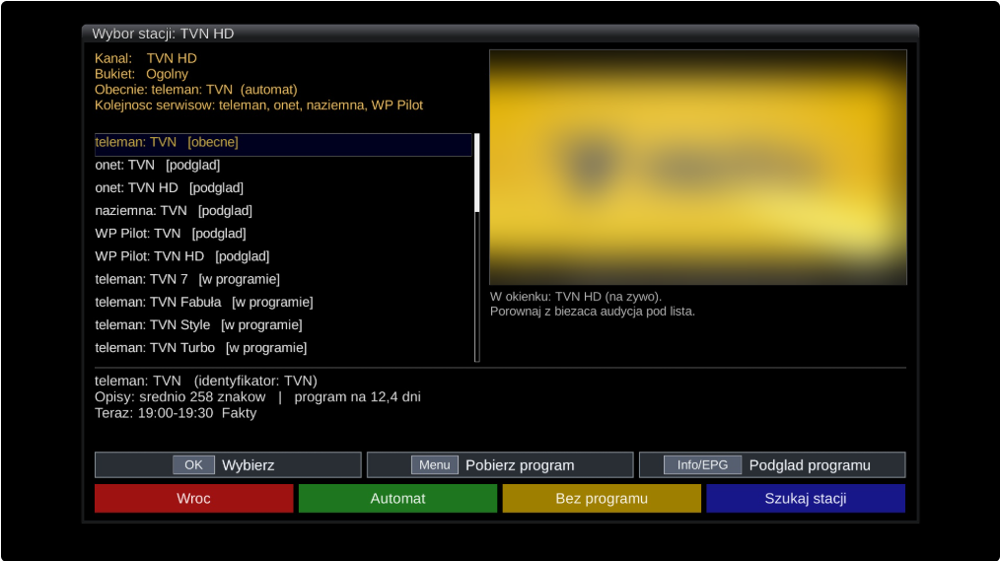
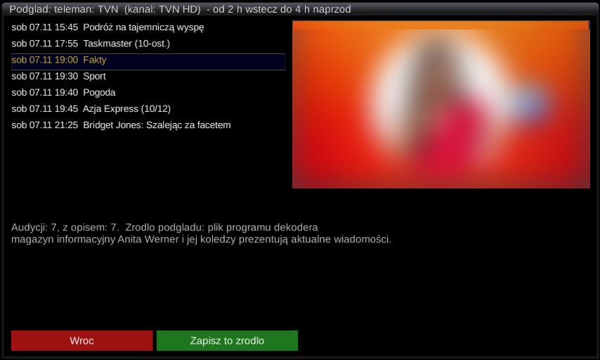
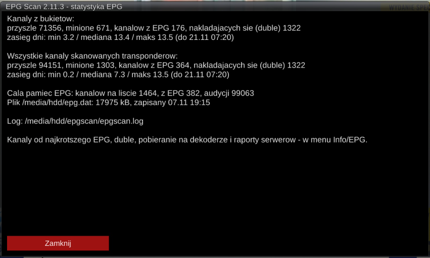
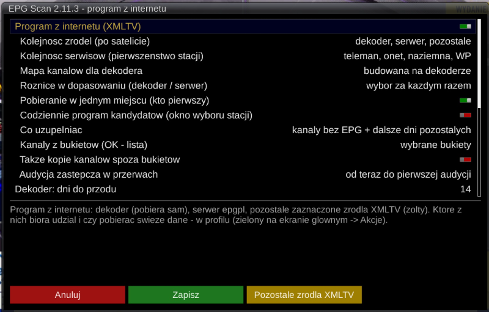

# EPG Scan

An Enigma2 plugin (OpenPLi 9.x, Python 3) that keeps the electronic programme guide (EPG) complete and up to
date on its own. It combines three listing sources and one tool that looks after your channel list:

- **satellite** – parallel scanning of transponders on free tuners (EIT),
- **channel parameters** – separate PAT/PMT and audio/video/subtitle/teletext PID scan for each DVB channel in the
  selected bouquets, with audio selection and optional E2Stream propagation,
- **internet listings** – Polish TV listings downloaded directly on the receiver
  (teleman.pl, programtv.onet.pl, programtv.naziemna.info, pilot.wp.pl) plus XMLTV import,
- **epgpl server** (optional) – a ready-made listings file prepared on a server in your home network,
- **SatWatch** – watches for changes on the satellite (`satellites.xml`, transponders) and repairs bouquets
  when a broadcaster changes channel parameters or identifiers.

Everything can run at night in standby on a schedule; in the morning you get a short summary.



The plugin was built with Polish channels on Hotbird 13.0E in mind, but the satellite scan, XMLTV import and
SatWatch work with any orbital position and any bouquets.

**Language of the user interface:** the on-screen texts are in Polish. This document gives the Polish menu
names in *italics* followed by an English translation, so you can find each item on screen.
Polish version of this description: [README.md](README.md).

---

## Contents

1. [Installation and removal](#1-installation-and-removal)
2. [First steps](#2-first-steps)
3. [Main screen](#3-main-screen)
4. [Actions and profile](#4-actions-and-profile)
5. [What happens during a run](#5-what-happens-during-a-run)
6. [Satellite – transponder scan](#6-satellite--transponder-scan)
   - [Channel parameters (PAT/PMT)](#channel-parameters-patpmt)
7. [Internet listings](#7-internet-listings)
8. [SatWatch – satellite changes and bouquets](#8-satwatch--satellite-changes-and-bouquets)
   - [8.4 Tuner setup – what to set in the system and what in the plugin](#84-tuner-setup--what-to-set-in-the-system-and-what-in-the-plugin)
9. [Schedule, night run and restart](#9-schedule-night-run-and-restart)
10. [EPG backups, log, disk cleanup](#10-epg-backups-log-disk-cleanup)
11. [Channels menu](#11-channels-menu)
12. [Reports](#12-reports)
13. [All settings](#13-all-settings)
14. [Files created by the plugin](#14-files-created-by-the-plugin)
15. [FAQ](#15-faq)

---

## 1. Installation and removal

**.ipk package** (recommended) – copy the file to `/tmp` on the receiver:

```
opkg install /tmp/enigma2-plugin-extensions-epgscan_X.Y.Z_all.ipk && init 4; sleep 2; init 3
```

**ZIP archive**:

```
rm -rf /usr/lib/enigma2/python/Plugins/Extensions/EPGScan;cd /tmp && unzip -o epgscan-X.Y.Z.zip -d /usr/lib/enigma2/python/Plugins/Extensions/;init 4; sleep 2; init 3
```

The plugin appears in **Menu → Extensions** and in the plugin list as **EPG Scan**.

Optional: the `enigma2-plugin-extensions-epgimport-sources` package (Rytec and other XMLTV source lists).
The EPG Import plugin is **not needed** – EPG Scan has its own XMLTV import.

**Removal**: `opkg remove enigma2-plugin-extensions-epgscan` removes the plugin only (settings stay).
To remove everything including configuration, reports and backups, use `epgscan_reset.sh` from the repository
(first a preview, then `--run`). The script backs up everything it deletes (see [chapter 14](#14-files-created-by-the-plugin)).

---

## 2. First steps

Nothing happens on its own after installation: the schedule is off, and so are internet listings and SatWatch.
After Enigma2 starts, the plugin only checks whether the EPG is empty (and restores a backup if it has made one).

Suggested order:

1. **Blue → *Satelita – EPG*** (Satellite – EPG) – *Kanały z bukietów (OK – lista)* (channels from bouquets, OK –
   list): the bouquets to scan (all by default) and the number of tuners.
2. **OK** – first satellite scan. Every transponder and the progress are shown on screen.
3. **Blue → *Program z internetu*** (internet listings) – switch on *Program z internetu (XMLTV)* if you want full
   14-day listings also for channels that get only a few hours or nothing from the satellite.
4. **Green (*Akcje*, Actions)** – tick the sources (e.g. *Dekoder* – the receiver itself); **yellow** saves this as the
   default profile.
5. **Menu → *Kanały* → *Dopasowanie kanałów: dekoder*** (channel matching: receiver) – check that each channel got
   the right station.
6. **Blue → *Harmonogram*** (schedule) – switch on the night run (e.g. 3:00, in standby).

---

## 3. Main screen



At the top: number of transponders and channels, parallel scan limit, free tuners, changes since the last scan.
Below: the latest result of each part (SatWatch, satellite, download, import), the current profile and the next
scheduled start, then the list of transponders with their state.

The plugin's selection lists (menus, filters, synchronisation, sorting) use the full screen width without a
picture-in-picture window, so long lines fit. The live picture is kept where it is useful: in the station selection
window, in the listings preview and in the SatWatch decision window.

| Key | Action |
|---|---|
| **OK** | start with the default profile |
| **Green – *Akcje*** | one-off start with different settings, or change the profile |
| **Yellow – *Kopie EPG*** | restore the EPG from a backup / make a backup now |
| **Blue – *Ustawienia*** | settings groups, including SatWatch (while working: leave the screen, work continues in the background) |
| **Menu – *Kanały*** | SatWatch, channel-to-station matching, map report (also during a scan) |
| **Info/EPG – *Raporty*** | statistics, EPG coverage, duplicates, SatWatch reports, log, plugin and server description (README) |
| **Red / Exit** | leave (work continues in the background) or abort |

You can close the screen at any time – scan, download and import run in the background and a notification
appears when they finish.

---

## 4. Actions and profile



***Akcje*** (green) is the list of steps of a run. What is ticked here is what **OK** on the main screen and the
schedule do (after saving it with yellow as default). Green/OK inside *Akcje* runs once without changing the profile.

| Item | Meaning |
|---|---|
| **SatWatch** | *no* / *changes* (compare `satellites.xml`, scan only changed transponders, repair bouquets) / *full transponder scan* |
| ***Czyść EPG przed startem*** (clear EPG first) | *don't clear* (merge with the existing EPG) / *whole EPG only on scheduled runs* / *whole EPG on every scan* / *scanned channels only* (if the image supports it) |
| ***Satelita*** | transponder scan (EIT) |
| ***Dekoder*** | listings downloaded by the receiver from Polish websites |
| ***Serwer epgpl*** | *fallback* (the server's file when the receiver has none of its own) / *always* / *no* |
| ***Pozostałe źródła XMLTV*** (other XMLTV sources) | XMLTV lists ticked in the settings |
| ***Pobierz świeże dane*** (fetch fresh data) | *yes – in one place*: if the other side (server or receiver) already has today's full package, it is used instead of downloading; *yes – download again*: always download; *no*: use existing files (still downloads if a file is missing or older than 30 h) |

Below the list you see a description of the selected item and the full order of steps, e.g.
`SatWatch (changes) -> satellite -> receiver -> server (fallback) -> others`.

---

## 5. What happens during a run

1. **SatWatch** (if enabled) – checks `satellites.xml`. No changes = continue at once, no tuner used. Changes = scan
   of the changed transponders (waits at most 15 min for a free tuner), bouquet repair, then a 10 s pause to free
   the tuners.
2. **EPG clearing** – according to the profile.
3. **Satellite** – parallel tuning of transponders on free tuners (keeping a reserve for the user), collecting EIT
   until no new events arrive.
4. **Listings download** – in parallel with the scan: the receiver downloads the Polish websites, the epgpl server
   (if present) – according to the profile.
5. **XMLTV import** – after the satellite scan: channels without EPG get the full listings; other channels get
   listings only in gaps between existing events and after them. EIT is temporarily disabled during the import
   and restored to its previous state afterwards when supported by the image.
6. **EPG backup** to disk, summary, optional restart (only after the night run and only when needed).

Existing events, including earlier XMLTV imports, have priority over the new XMLTV import. Once EIT is restored,
Enigma2 may update the guide with satellite data.
OpenPLi derives XMLTV event IDs from their start time. If an ID conflicts with another event on the channel,
the importer skips the conflicting entry and logs a warning rather than risk replacing existing listings.

---

## 6. Satellite – transponder scan

- Transponders of channels from the selected bouquets are scanned (or all from `lamedb`).
- Several transponders at once (*Maks. równoległych skanów* – max parallel scans), always with a *reserve of free
  tuners*. When the user or a recording needs a tuner, the scan gives it back and returns to the transponder later.
- A transponder a tuner is already on (the channel you are watching) is scanned "on the way" without taking
  another tuner.
- A transponder is finished when no new events arrive for *N s* (min./max. time can be set).
- Transponders without EPG can be skipped and rechecked every few days.
- **EIT switched off in the Enigma2 EPG settings**: the plugin switches it on for the scan or permanently. When the
  satellite import is off, it can force EIT off (EPG from XMLTV only).
- **Hung tuner**: 3 failed tunings in a row on the same tuner (different transponders) = log entry with the state of
  all tuners and a note in the night summary; at night in standby Enigma2 is restarted and the run repeated (at most
  once per night), on a manual start you are asked about a restart.
- Before a timer recording the plugin keeps tuners free and pauses new scans.

---

### Channel parameters (PAT/PMT)

This is a separate task: it does not replace the EPG scan and does not clear or modify the EPG database. It scans
each unique DVB service in the selected bouquets, grouped by transponder. The scan keeps a tuner reserved for each
group and tunes its channels in sequence before releasing the tuner for another group. EPG Scan's parallel limit
and free-tuner reserve are respected; at least two tuners are kept free (one on receivers with fewer than three
tuners). With six tuners and a reserve of two, up to four groups can run at once. If watching, streaming or a
recording needs a tuner, the scan releases a group and resumes it later. IPTV and unknown service types are reported
as unsupported; tuning and table-read errors are included in the report.

Run it independently of EPG: on the main screen choose **Actions**, select
**Channel parameters (PAT/PMT)**, then press **OK** or **Green**. The scan runs in the background and the main
screen shows progress; **Blue** closes the screen without stopping the scan, so you can resume watching.
Review results and choose audio tracks from **Menu → Kanały → Skan parametrów kanałów (PAT/PMT)**. You can also
start the scan from that screen with **Menu**.
Audio preferences can come from Enigma2's automatic-audio settings or a manually ordered list (for example
`pol,eng`). A unique preferred-language match is recommended automatically; missing or ambiguous matches need
review. **OK** selects an audio PID. **Yellow** tunes the channel and opens Enigma2's standard audio selector so
you can listen to tracks. Preview is refused while recording, and the original channel is restored when leaving
the screen. **Green** confirms and saves the choices.

Channel parameters have a separate settings group and an independent schedule with its own time and weekdays,
standby/recording conditions, and optional wake-up/return from deep standby. This schedule runs even when EPG
scheduling is off or no EPG scan was started.

**Blue** in the results screen provides two separate, confirmed operations:

- add only missing audio/PMT values to `common.json` as defaults for new devices (existing entries are preserved);
- select specific E2Stream receivers and update their profiles; backups are made before writing.

PMT data is sent only when its SID is not ambiguous across scanned services. Results are stored in
`/etc/enigma2/epgscan/channelparams.json`.

---

## 7. Internet listings

### 7.1 Download on the receiver

The receiver itself downloads listings of Polish stations from four websites: **teleman.pl, programtv.onet.pl,
programtv.naziemna.info, pilot.wp.pl** – 14 days ahead by default, in the background, usually within minutes.

- A separate number of connections per website, an overall limit and a pause after every page (1 s by default) – so
  the websites are not overloaded. When a website rate-limits (HTTP 429/503), the pause for that website grows
  automatically (up to 5 s).
- Pages that failed are retried; a website having no data for a given day is not an error.
- Result: XMLTV file `pl.xml.xz` in the backup directory (`…/epgscan/lokalne/`) and the XMLTV source
  **"EPG PL (dekoder)"**. The file is replaced only after a successful download.
- Download errors can be written to `lokalne/bledy.txt`.

### 7.2 Channel map (which channel gets which station)

Built on the receiver from your bouquets and the websites' station lists: matching by name (ignoring "HD",
"Poland" etc., with a name-extension rule, e.g. regional TVP3); copies of a channel on other transponders get the
same listings. Manual choices made in **channel matching** win and are saved in `/etc/enigma2/epgscan/wskazania.txt`.
Next come your text mappings `/etc/enigma2/epgscan/aliases.txt` and the package mappings `aliases.dist` – the same
files and rules as on the epgpl server.

Alternatively the map can come from the epgpl server (*Mapa kanałów dla dekodera*).

### 7.3 XMLTV import

Own import (no EPG Import plugin needed):

- sources: *EPG PL (dekoder)*, the epgpl server, lists from the `epgimport-sources` package (e.g. Rytec), your own
  lists by URL or from `/etc/enigma2/epgscan_sources/wlasne`; without the package – a built-in list of mirrors,
- adjustable source order (e.g. receiver → server → others),
- *Co uzupełniać* (what to fill): only channels without EPG, or also gaps and later days of the others,
- channels from the selected bouquets (all / selected / those being scanned) and optionally copies of channels
  outside the bouquets,
- **placeholder events** ("Brak programu do HH:MM" – no listings until HH:MM) in gaps, so the channel is visible in
  Multi EPG even when the first event starts later.

### 7.4 epgpl server (optional)

A separate project running on a Linux server in your home network that prepares a ready listings file. EPG Scan
uses it as a **fallback** (when the receiver has no fresh file) or **always**. Without the server the plugin is fully
functional – the receiver does everything.

**Adding the server**: *Ustawienia → Program z internetu* → yellow (XMLTV sources) → blue → *Szukaj serwera epgpl
w sieci* (search for an epgpl server). EPG Scan asks via Avahi (mDNS, service `_epgpl._tcp`), then scans the
receiver's subnet (port 8088, about 20 s). Found servers are shown with the date of their listings file; choosing
one adds the source. You can also type the address manually. After adding a server, the receiver sends it its
settings (bouquets, website order) and compares the channel matching – differences are handled according to
*Różnice w dopasowaniu* (ask / receiver wins / server wins / leave).

**Downloading in one place** (*Pobieranie w jednym miejscu*, on by default; epgpl 0.18.0+): for scheduled downloads
only whoever is first downloads. If the server has downloaded full listings today (successful run, as many days as
the receiver wants, data for at least 90% of stations), the receiver takes its package – listings, reference map and
candidate listings – instead of downloading. While the server is downloading, the receiver waits (at most 90 min).
If the receiver was first, it uploads its package to the server afterwards and the server's schedule skips today's
download; during the download the receiver tells the server it is busy, so the server does not start in parallel.

---

## 8. SatWatch – satellite changes and bouquets



### 8.1 Checking for changes

SatWatch compares the transponders of the monitored positions (13.0E by default) with the current OpenPLi
`satellites.xml` (GitHub):

- **no changes** – does nothing and uses no tuner,
- **changes** – updates `/etc/enigma2/satellites.xml` (with a backup; the system file `/etc/tuxbox/satellites.xml` is
  never changed) and scans only the changed/new transponders,
- **no local file or position** – restores the file from the remote version, no scan, reports that a restart is needed,
- failed transponders are retried in the background when all tuners are free,
- **full scan** of all transponders of a position – from *Akcje* or once a week on a chosen day.

The scan uses one free tuner (you keep watching as long as the "reserve of free tuners" is left). The **preferred
scan tuner** is chosen in the SatWatch settings from the receiver's DVB-S tuners; if it is busy, another free tuner is
used at once. "Automatic" = the highest free tuner. Progress (e.g. `Skan 19/73 (26%, zostało ok. 4 min) 11258 H 27500
(tuner H)`) is shown in the SatWatch list and on the EPG Scan main screen; details in `satwatch.log`.

With an FBC tuner and Unicable, Enigma2 may refuse a scan while a tuner of the same group (same antenna input) is
busy – watching, fast channel change (FCC) or streaming. A second cable to input B and two tuner groups help
(see 8.4).

After the scan, services no longer found on a scanned transponder can be removed from `lamedb` (with protection
against a "suspicious" transponder where less than half of the channels were found). With removal off, the report
still lists them, and bouquet channels pointing to them go to replacement or decision like lost channels
(list: `/etc/enigma2/satwatch/nieaktualne.json`).

### 8.2 Bouquet repair

SatWatch keeps a snapshot of `lamedb` and the bouquets. When a bouquet channel disappears (SID/TSID change, move to
another transponder, renaming), it looks for a candidate in the current `lamedb` and **replaces it automatically** when:

1. the name is identical,
2. the name is the same after ignoring HD/4K/Poland and spaces,
3. there is exactly one similar candidate (≥ 75%) with the same first word.

With several candidates the tie is broken by: *already in your bouquets*, *new*, *same stream (TS)*, *same SID*.
Other channels go **to decision**. A bouquet backup is made before every change.

Candidates are searched by name and SID; broadcaster and transponder raise their rank. When a broadcaster changes
both name and SID, the candidates offered are channels from the same stream (TS) or the same broadcaster on that
transponder – new ones and those not in your bouquets first. Such channels are never replaced automatically.

### 8.3 Channels awaiting decision



**Menu → *Kanały* → *SatWatch* → *Kanały do decyzji***: the list of channels; after choosing one, the decision screen:

- at the top the old channel's data (name, broadcaster, transponder, SID, type, where in bouquets, reason),
- list of candidates (name, SID, tags "SID matches", "in bouquets", "from this TP"),
- **preview window** – green switches to the candidate; after leaving, the previously watched channel returns,
- below the list the candidate's details: SID same/different, same/other transponder, broadcaster, name match, type,
  whether it is already in your bouquets (a replacement would create a duplicate),
- **OK** – replace, **yellow** – remove the channel from bouquets, **blue** – leave as is.

**Menu → *Kanały* → *SatWatch*** – one list of all actions (SatWatch settings: *Ustawienia → SatWatch – transpondery*):

| Action | What happens |
|---|---|
| *Sprawdź teraz* (check now), *Pełny skan* (full scan, after confirmation), *Napraw bukiety* (repair bouquets) | starts in the background, short message, back to the list; progress at the top of the list (live: "Przerwij skan (Skan 21/73 – 27%, …)" – abort scan, after the end "Skan zakończony: …") and on the main screen; result in the reports |
| *Kanały do decyzji* | channel list and decision screen (8.3) |
| *Podgląd bukietów* (bouquet preview) | window comparing the bouquets with the snapshot |
| *Zapisz zrzut*, *Akceptuj obecny stan*, *Przeładuj transpondery* (save snapshot, accept current state, reload transponders) | result in a message, back to the list |
| *Przywróć kopię bukietów / satellites.xml* (restore backup) | list of backups (newest first); after choosing: restore, reload lists/transponders, message |
| *Konfiguracja tunerów* (tuner setup) | advice: what to set in the system, EPG Scan and SatWatch (8.4) |

SatWatch reports (latest, history) and log are in **Info/EPG → *Raporty***.

### 8.4 Tuner setup – what to set in the system and what in the plugin

The EPG scan (EIT) and the satellite scan (SatWatch) need tuners. To run unattended without getting in the way of
watching, recording and streaming, part is set in the system (Enigma2) and part in the plugin. The plugin detects
the tuner layout and gives advice: ***Raporty → Konfiguracja tunerów*** or ***Menu → Kanały → SatWatch → Konfiguracja
tunerów***; a short hint is also shown under the "reserve of free tuners" and "preferred scan tuner" settings.

| Receiver | System (Enigma2) | EPG Scan | SatWatch |
|---|---|---|---|
| **1 tuner** | nothing | reserve 0, night schedule, "wait while recording" | reserve 0, preferred: automatic |
| **2 or more regular tuners** | last tuner (e.g. B) – priority **1** (lower than AUTO), the others AUTO | reserve 1 | preferred = that tuner (B), reserve 1 |
| **FBC, one antenna input** | all tuners in one group – see below | reserve 1 | satellite scan usually only when tuners are free (at night, in standby) |
| **FBC, two inputs** (recommended) | A + linked C…H – priority AUTO; **B with no linked tuners – priority 1** | reserve 1 | preferred = **B**, reserve 1 |

Tuner priority: Enigma2 menu → Setup → Tuners and scanning → Tuner configuration → the tuner (menu names may differ
between images). Enigma2 uses the lower-priority tuner last for watching and recording, so it is usually free for
scanning. If the preferred tuner is busy, SatWatch takes another free one at once; if Enigma2 refuses a tuner, it
tries the next.

**One tuner.** The EPG and satellite scans occupy the only tuner – meanwhile you cannot watch or record a channel on
another transponder. That is why both run at night in standby. The reserve must be 0, otherwise the scan never starts.

**Two tuners.** Give one (usually the second) a lower priority in the system and pick it in SatWatch as preferred.
Watching and recording use the first, scanning the second.

**FBC (Full Band Capture).** One VU+ DVB-S2 FBC module is one tuner with **two antenna inputs** (A, B) and
**8 demodulators** (A–H). C–H have no socket of their own – each uses input A or B (set in the tuner configuration;
factory 3 + 3, but e.g. 6 + 0 is possible). The number of tuners does not depend on the number of cables: with one
cable (B looped from A) there are still 8. With one input Enigma2 may **refuse a satellite scan** while something in
that input's group is busy – watching, fast channel change (FCC), a stream to a client. The EPG scan works normally.
Solution: a second cable to input B and two groups – a large one for watching, a small one (B) for scanning. With
Unicable each tuner needs its own SCR, unique on its cable.

**Example: VU+ Uno 4K SE (OpenPLi 9.2), FBC 8 tuners, Unicable (SCR 9–16), Hotbird 13.0E, FCC for 3 channels,
streaming to clients.**

| Setup | Test result |
|---|---|
| one cable; A: C, E, G; B (loop from A): D, F, H | full satellite scan (73 TP, about 5 min) **only in standby**; while watching or with a streaming client connected Enigma2 gave no tuner to the scan |
| one cable; B…H linked to A; B priority 1, SatWatch preferred B | B is not used for watching, but the scan is still **refused** – B is in the same FBC group as the busy A |
| two cables; A: C, E, G; B: D, F, H | scan works while watching, but with FCC (3 channels) and streaming group B tuners are often busy too – no free group for the scan |
| **two cables; A + C, D, E, F, G, H – priority AUTO; B alone – priority 1; SatWatch: preferred B** | **watching + FCC + streaming on group A, satellite scan on B at any time** |

---

## 9. Schedule, night run and restart

- **Mode**: at a time on chosen days, or every N hours; **only in standby** (waits for standby) or always.
- Optional: wait while a recording is running; **wake from deep standby** and return to it afterwards.
- A run interrupted by a receiver restart is repeated after start-up.
- **Daytime satellite update** (*Aktualizacja satelitarna w ciągu dnia*): every N hours scans either all
  transponders (default, including existing installations) or only those with soon-ending EPG. The latter
  considers all EPG, including XMLTV, and does not detect internal gaps. It can run always or only in standby,
  optionally at a fixed time. A new E2Stream pack is built after the scan if the client server and packs are enabled.
- **SatWatch: full scan once a week** on a chosen day (on other days – checking for changes only).
- **Channel parameters**: a separate schedule with its own time and weekdays, independent of EPG scanning.
- **Restart after the night run** (*never* / *when needed* / *always*). "When needed" means: tuners do not tune, low
  free memory, Enigma2 uses much more memory than after start-up, SatWatch updated `satellites.xml`, optionally
  preventively every N days. Restart only in standby, with no recording now or within 15 min, at most once per 20 h.
- **Night summary** – after you switch the receiver on (after about a minute of actual use) a window with the main
  events: restart and its reason, hung tuner, channels awaiting decision, errors.

---

## 10. EPG backups, log, disk cleanup

- **EPG backup after a scan** to the backup directory (default `/media/hdd/epgscan/`), keeping the last N.
- **Restore at start-up when the EPG is empty** – automatically or after asking (two measurements a minute apart).
- **Yellow – *Kopie EPG*** on the main screen: restore a chosen backup or back up now.
- **Log** `epgscan.log` in the backup directory (or in `/tmp`); a few previous runs in `epgscan.log.1`, `.2`…
- **Disk cleanup** (off by default): every N minutes deletes, from the selected directories, timeshift files older than
  N hours (files in use are skipped) and keeps the N newest Enigma2 crash logs (counted across all directories).
  Directories are chosen from a list: storage devices, the timeshift and crash-log directories from the Enigma2
  settings, and your own.

Bouquet selection looks the same everywhere – ***Kanały z bukietów (OK – lista)***: in *Satelita – EPG* (scan), in
*Program z internetu* (listings and channel map) and in SatWatch (watched bouquets). OK opens the bouquet list, OK on an
item ticks/unticks it, green saves, red cancels.

---

## 11. Channels menu



1. **SatWatch** – list of SatWatch actions: check, scan, channels awaiting decision (8.3), snapshot, backups, tuner
   setup (settings are in *Ustawienia*, SatWatch reports and log in *Raporty*).
2. **Channel parameters (PAT/PMT)** – scans all DVB channels in the selected bouquets. Menu starts or stops a
   scan, OK selects an audio PID, yellow opens the listening preview, green confirms choices, and blue writes
   them to E2Stream.
3. ***Dopasowanie kanałów: dekoder*** (channel matching: receiver) – channels from your bouquets and their assigned
   stations. Keys: **OK** – choose the source (station selection window), **Menu** – sorting (bouquet order /
   alphabetical) and listings download (on the server, ready file, on the receiver), **Info/EPG** – differences with
   the other map and synchronisation (below), red – close, green – refresh, yellow – filter (all / unmatched / no
   listings / manual only / teleman / onet / naziemna / WP Pilot / differs from the other map / proposed changes),
   blue – bouquets (all / selected / those being scanned; the same setting decides which channels get internet
   listings; a choice is required on first opening).

   **Station selection window** (same for receiver and server): at the top the channel, bouquet, current source and a
   live picture of the channel – the plugin switches to it (if there is no free tuner, a message is shown), and the
   previous channel returns afterwards. The list: current source at the very top, then the best candidates (equal
   scores in website order), then stations sharing a word in the name (e.g. *Historia Poland* → *Discovery Historia*).
   Below the list: website, station, average description length, how many days of listings and the current event –
   for stations already in the listings file (others: "–"). Keys: **OK** – choose, red – back, green – **automatic**
   (remove the manual choice), yellow – no listings, blue – search stations, **Menu** – download listings of the
   selected station or of all candidates without listings (in the background; with a proposed change also "skip
   proposal"), **Info/EPG** – preview of the station's listings from 2 h back to 4 h ahead (green "save this source").

   <p> </p>

   **Receiver / server differences:** with an epgpl server the list is compared with the other map (different station
   or a manual choice on one side only) and shows "differs from the server: N". **Info/EPG**: show differences
   (separate window: list of channels, below it the full receiver and server sources; green – take from the receiver,
   yellow – take from the server, blue – all at once), synchronise – receiver wins / server wins, compare again.
   A winning manual choice is copied to the other side; when "automatic" wins, the other side loses its manual choice;
   when both sides are automatic with different sources, the winner's source is pinned on both sides. Setting
   *Program z internetu → Różnice w dopasowaniu*: ask every time (default) / receiver wins / server wins (synchronised
   automatically on opening) / leave different. Bulk synchronisation requires epgpl 0.17.0, comparing manual choices
   outside the common map requires epgpl 0.19.3.

   **Proposed changes `[!]`:** on every map load, channels with a manual choice are checked: the chosen station no
   longer exists on the website, it gave no listings in the last download, or there is a station with exactly the
   channel's name. The list shows `[!]`, the header "Propozycje zmian: N", the reason and proposed station below the
   list; in the selection window the proposed station is right under the current one (`[propozycja]`).

   **Candidate listings:** option *Program z internetu → Codziennie program kandydatów* (off by default; also applies
   on the epgpl server). When on, after every successful download one day of listings is fetched in the background for
   all candidates the selection window offers to bouquet channels. Used only for the preview in the selection window –
   it does not go into the EPG.
3. ***Dopasowanie kanałów: serwer*** – the same for the epgpl server's map (when there is a server).
4. ***Przenieś wskazania z serwera do dekodera*** – copy manual choices from the server to the receiver.
5. ***Raport mapy kanałów dekodera*** – receiver channel map report.

---

## 12. Reports



**Info/EPG** on the main screen:

- **SatWatch** – latest report, history (last 30), log,
- **EPG statistics** – number of events, channels with EPG, coverage in days, duplicates,
- **Channels – EPG coverage** (shortest first), **Duplicates** – overlapping events,
- **Download on the receiver** – last result, file, stations per website, errors,
- **Receiver / server comparison** and **comparison test** (with an epgpl server),
- **EPG Scan log** (newest first), **epgpl server reports**,
- **Tuner setup** – advice for the detected tuner layout,
- **Plugin description (README)** and **epgpl server description (README)** on the receiver screen.

---

## 13. All settings

**Blue → *Ustawienia***, five groups, starting with SatWatch. Defaults in brackets. Every option has a description
below the settings list.

### *SatWatch – transpondery*
| Setting | Description |
|---|---|
| Action on satellites.xml changes | report only / report + update `/etc/enigma2/satellites.xml` with backup (report + update) |
| Scan changed TPs automatically | after the file update, scan only new and changed TPs (yes) |
| Full scan once a week, day | in the EPG Scan night run, all TPs of the monitored positions (yes, Sunday) |
| Remove stale services after scan | removes from lamedb services not found on a scanned TP; off – report and decisions without removal (yes) |
| Replace channels in bouquets automatically | only with a certain candidate, the rest goes to decision (yes) |
| Time for the scan with busy tuners | how long to wait for a free tuner (2 h) |
| Resume an interrupted scan when tuners are free | finish later, within 24 h (yes) |
| Reserve of free tuners | (1; 0 with a single tuner) |
| Preferred scan tuner | list of the receiver's DVB-S tuners; busy – another free one (automatic) |
| Monitored positions | OK – list of positions from `satellites.xml` to tick, positions used by your tuners at the top (13.0E) |
| File update scope | selected positions / whole file (selected positions) |
| Frequency tolerance [MHz] | a TP shift that is not a change (3) |
| Channels from bouquets (OK – list) | TV bouquets, below them radio bouquets marked *(radio)*; ticked ones are watched, new bouquets at once (all except Last Scanned) |
| Snapshot and bouquet report on each check | (yes) |
| Reload transponders after update | without a GUI restart (no) |
| Log and report history directory | internal memory / disk / USB (internal memory) |
| On-screen notification | never / only on changes / always (only on changes) |
| Number of satellites.xml backups | (5) |
| Verify SSL certificate | (yes) |
| satellites.xml address | OK – list: built-in OpenPLi tuxbox-xml and your own (yellow – add, checked before saving; green – edit; blue – delete; OK – default) (OpenPLi) |

### *Satelita – EPG* (satellite EPG scan)
| Setting | Description |
|---|---|
| EPG import from satellite | transponder scan (yes) |
| Force EIT on | when EIT is off in Enigma2: *for the scan* / *permanently* (for the scan) |
| Force EIT off | when the satellite import is off (yes) |
| Channels from bouquets (OK – list) | arrows: all bouquets / selected bouquets / all transponders from lamedb; OK – bouquet list, saving sets *selected bouquets* (all bouquets) |
| Max parallel scans | (4) |
| Reserve of free tuners | for the user and recordings (1) |
| Min. / max. time on a transponder | (30 s / 180 s) |
| End after no new events | (60 s) |
| Skip transponders without EPG / recheck every | (no / 7 days) |

### *Program z internetu* (internet listings)



| Setting | Description |
|---|---|
| Internet listings (XMLTV) | switches the whole internet part on (no) |
| Source order | receiver / server / others in any order (receiver, server, others) |
| Website order | which website wins when a station is on several (teleman, onet, naziemna, WP); also used by the epgpl server |
| Channel map for the receiver | built on the receiver / from the epgpl server (receiver) |
| Matching differences (receiver / server) | ask every time / receiver wins / server wins / leave different (ask every time) |
| Daily candidate listings (station selection window) | one day of listings for candidates after every download, receiver and server – about 1000 stations (no) |
| Download in one place (whoever is first) | schedule: the receiver or the server downloads – whoever is first, the other takes the package (yes) |
| What to fill | channels without EPG / also gaps and later days of the others (gaps and later days) |
| Channels from bouquets (OK – list) | arrows: all bouquets (including IPTV) / selected bouquets / bouquets being scanned; OK – bouquet list, saving sets *selected bouquets*; the same bouquets are matched in the channel map (all) |
| Also copies of channels outside bouquets | (yes) |
| Placeholder event in gaps | no / from now to the first event / also gaps from 30 min (from now to the first event) |
| Receiver: days ahead | (14) |
| Connections: teleman / onet / naziemna / WP Pilot, max total | (4 / 3 / 2 / 1, 10) |
| Pause between pages | after every page on every connection; extended automatically up to 5 s on 429/503 (1 s) |
| Log download errors | (yes) |
| Yellow: other XMLTV sources | tick lists, add your own addresses (blue) |

### *Harmonogram* (schedule and top-up)
| Setting | Description |
|---|---|
| Schedule on / mode | switch (yes); mode: off / at a time on chosen days / every N hours (off) |
| Time, weekdays, every N hours | (3:30, all days, 6 h) |
| When to run | only in standby / always (only in standby) |
| Wait while recording | (no) |
| Wake from deep standby / return afterwards | (no / yes) |
| SatWatch: full scan once a week, day | (yes, Sunday) |
| Daytime satellite update | (no); all transponders (default, including existing installations) / short EPG only; every (3 h), threshold for short EPG (6 h), when (always), optionally at a fixed time (no, 14:00) |

### *Kopie EPG* (backups, log, notifications, restart, disk cleanup)
| Setting | Description |
|---|---|
| Notification after background work | (yes) |
| EPG backup after scan, directory, number of backups | (yes, `/media/hdd/epgscan/`, 3) |
| Restore EPG at start-up when empty | off / ask / automatically (automatically) |
| Write log | in the backup directory / in `/tmp` (in the backup directory) |
| Restart after the night run | never / when needed / always (when needed) |
| Preventively every [days], free memory threshold | (no, 100 MB) |
| Disk cleanup | (no); directories (OK – list: storage devices, timeshift and crash-log directories from Enigma2, your own – yellow add, blue remove; `/media/hdd`), timeshift older than (6 h), keep crash logs – in total (10), every N minutes (15) |

---

## 14. Files created by the plugin

| File / directory | Contents |
|---|---|
| `/etc/enigma2/settings` | settings `config.plugins.epgscan.*` and `config.plugins.satwatch.*` |
| `/etc/enigma2/epgscan/wskazania.txt`, `aliases.txt` | manual station choices, your own mappings (same names as on the server) |
| `/etc/enigma2/epgscan/channelparams.json` | PAT/PMT scan results and confirmed audio selections |
| `/etc/enigma2/epgscan_sources/` | copies of XMLTV source lists, your own lists, the "EPG PL (dekoder)" source |
| `/etc/enigma2/epgscan_tps.json`, `epgscan_xmltv.json`, `epgscan_wakeup` | transponder state, sources, wake-up |
| `/etc/enigma2/satwatch/` | SatWatch state, bouquet snapshot, backups of bouquets and `satellites.xml` |
| `/etc/enigma2/satellites.xml` | only when SatWatch has updated transponders |
| `/media/hdd/epgscan/` | EPG backups, log, `lokalne/` (downloaded listings, channel map, reports) |
| `/media/hdd/satwatch/` | SatWatch log and report history (when this directory is chosen) |

The plugin does **not change**: bouquets (except repairs by SatWatch, always with a backup), tuner settings, the
system file `/etc/tuxbox/satellites.xml`, cron. It changes the EIT setting in Menu → EPG only according to the
options in the *Satelita* group.

---

## 15. FAQ

**Do I need the epgpl server?** No. The receiver downloads the listings and builds the channel map itself.

**Do I need the EPG Import plugin?** No. The `epgimport-sources` package is optional.

**Why does a channel have no EPG?** Info/EPG → *Kanały – zasięg EPG* (EPG coverage) and Menu → *Kanały* →
*Dopasowanie kanałów: dekoder* (filter *no listings*). You can choose a station manually and preview its listings
before saving.

**I am watching and SatWatch waits for a tuner.** While watching, fast channel change (FCC) or streaming, Enigma2 may
not give a tuner to the scan – especially with an FBC tuner on one antenna input. SatWatch waits (at most 15 min in a
run), and when there are no changes it does not use a tuner at all. How to set up tuners so the scan works while you
watch: [chapter 8.4](#84-tuner-setup--what-to-set-in-the-system-and-what-in-the-plugin).

**A channel disappeared from a bouquet after a change on the satellite.** Menu → *Kanały* → *SatWatch* → *Kanały do decyzji*.

**Where are the logs?** Info/EPG → *Log EPG Scan* and *SatWatch – log*; files in `/media/hdd/epgscan/` and
`/media/hdd/satwatch/`.

**Is the interface available in English?** Not yet – the on-screen texts are Polish. This document maps the menu
items to English.

## Support

If EPG Scan is useful to you and you'd like to support its development: **[buycoffee.to/jardol](https://buycoffee.to/jardol)**. Thank you!

## Disclaimer

TV listings downloaded from the websites (teleman.pl, programtv.onet.pl, pilot.wp.pl, programtv.naziemna.info) belong to
their owners. The plugin and the server download them for private use on your own receiver – with pauses between
requests and a limited number of connections. You are responsible for using them in line with those websites' terms;
do not share the downloaded listings with others. The repository contains only code and configuration – no downloaded
listings. The software comes without any warranty (see the GPL license for details).

## License

EPG Scan – GNU GPL version 2 or (at your option) any later version (GPL-2.0-or-later), full text in `LICENSE`.
Code and programs by other authors it uses (among others iptv-org/epg – Unlicense, Enigma2/OpenPLi – GPL-2.0), their
licenses and notes on data from TV listings websites: `THIRD_PARTY.md` (Polish).
